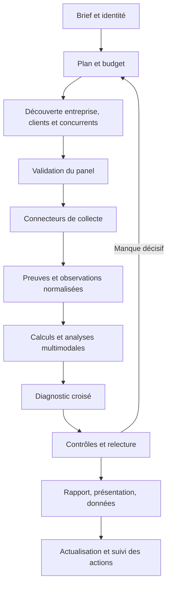

# Système IA d’audit marketing

Version de conception du 29 octobre 2026. Statut : cahier des charges et configuration de départ, pas application déployée. Périmètre initial proposé : PME françaises, avec Instagram, TikTok et Google Business Profile obligatoirement examinés. Les paramètres chiffrés ci-dessous sont des choix de conception à calibrer pendant le pilote.

## 1. Produit et critères de réussite

Entrée : entreprise, domaine, ville ou zone, objectif, offres prioritaires, accès éventuels. Une identité ambiguë déclenche une clarification avant toute analyse comparative.

Sortie : synthèse, benchmark, analyses détaillées, exemples consultables, plan à 90 jours, registre des preuves et couverture de collecte. Trois modes : audit public, audit connecté, actualisation différentielle. Aucune publication, réponse à un avis, prise de contact ou modification d’un compte dans le flux d’audit.

La réussite se mesure à l’exactitude des faits, la pertinence des comparables, la qualité des décisions et au coût de production. Le nombre de pages ne mesure pas la qualité.

## 2. Enseignements des solutions existantes

| Solution | Fonction documentée | Décision pour notre système |
|---|---|---|
| Vendasta Snapshot [S1] | Diagnostic automatisé de présence numérique, avec notes | Conserver une restitution standard, distinguer diagnostic commercial et preuve de progression |
| Socialinsider [S2] | Analyse TikTok concurrentielle et contenus | Tester la couverture sur des petites entreprises avant sélection |
| Rival IQ [S3, S4] | Données sociales publiques/privées et API | Réutiliser la collecte si droits, profondeur, coûts et export conviennent |
| BrightLocal [S5] | Comparaison des positions locales sur une grille | Reprendre le protocole géographique, vérifier séparément l’accès automatisé aux résultats |
| Clay [S6] | Enrichissement successif via plusieurs fournisseurs | Source structurée d’abord, recherche approfondie uniquement pour les manques utiles |

Ces documentations décrivent des capacités annoncées. Aucun fournisseur n’a été testé ni acheté dans ce travail. Un abonnement à une interface ne garantit ni API, ni droit de revente des données. La combinaison proposée n’est pas une affirmation d’exclusivité sur le marché.

## 3. Architecture logique

Application modulaire initiale : API et interface de travail, moteur de workflow durable, workers réseau, workers médias/IA, PostgreSQL, stockage d’objets. Les connecteurs externes restent derrière des interfaces remplaçables. Aucun besoin initial de multiplier les microservices ou d’ajouter une base graphe : les relations peuvent résider dans PostgreSQL.

Choix proposé : TypeScript pour API et domaine, Temporal pour orchestration durable [S13], workers médias séparés si nécessaire. Recherche textuelle PostgreSQL d’abord, index vectoriel seulement si les cas de recherche le justifient. Le choix du fournisseur de modèles reste interchangeable.

## 4. Workflow et responsabilités

| Étape | Travail | Contrôle de sortie |
|---|---|---|
| Cadrage | Objectif, territoire, offres, période, moyens | Identité et périmètre confirmés |
| Identification | Société, marque, groupe, établissements, comptes | Justification des rapprochements |
| Découverte | Offre, clients visibles, demande, acteurs | Candidats et sources enregistrés |
| Panel | Locaux, pairs, leaders et références créatives | Pertinence validée ou incertitude explicite |
| Collecte | Site, finances, social, Google, réputation, publicité | Manques et droits identifiés |
| Analyse | Calculs, vision, transcription, lecture des preuves | Sorties structurées et vérifiables |
| Synthèse | Écarts, hypothèses, actions, dépendances | Recommandations rattachées aux preuves |
| Relecture | Faits importants, ambiguïtés, utilité | Acceptation, correction ou complément |
| Livraison | Exports issus du même diagnostic | Versions et couverture affichées |

États de tâche : queued, running, waiting_provider, waiting_review, succeeded, partial, failed, skipped. Relances bornées avec temporisation, quotas par fournisseur et limite de concurrence. Clé d’idempotence par tâche et requête pour éviter les doubles appels payants. Un arrêt de budget produit un résultat partiel explicite, jamais une réussite silencieuse.

Le planificateur IA choisit dans un catalogue de tâches autorisées. Le code contrôle le budget et les transitions. Les pages et commentaires sont des données non fiables : leurs instructions ne peuvent changer la mission, accéder aux secrets ou déclencher des actions.

## 5. Identité, clients et concurrence

Séparer legal_entity, brand, location, website et social_account. Le CA du groupe ne devient pas celui d’un point de vente. Conserver source, exercice, devise, durée de l’exercice, périmètre consolidé ou social. Les comptes INPI couvrent les dépôts non confidentiels disponibles [S12].

Clients visibles : références, cas, portfolio, témoignages, collaborations et mentions croisées. Stocker relation revendiquée ou confirmée, date et segment. Un avis n’identifie pas nécessairement une société cliente. Un abonné n’est pas un client. Ne pas inférer de caractéristique personnelle sensible à partir d’images ou de noms.

Découvrir un ensemble de candidats, puis retenir par défaut jusqu’à 5 locaux, 3 pairs et 2 leaders. Dédupliquer et enregistrer les appartenances multiples. Taille inconnue reste inconnue. Similarité fondée sur besoin, offre, cible, territoire, gamme et modèle économique. Distinguer leader économique documenté, leader de visibilité et référence créative. L’entreprise la plus visible ne prouve pas la plus forte rentabilité.

## 6. Accès aux trois plateformes obligatoires

| Plateforme | Compte du client | Concurrents | Limite structurante |
|---|---|---|---|
| Instagram | OAuth et insights selon produit, permissions et métriques disponibles | Fournisseur validé, fonctionnalités officielles compatibles, observation assistée | Ne pas promettre les métriques privées concurrentes |
| TikTok | Display API pour profil/vidéos autorisés, exports ou intégrations approuvées pour analyses plus profondes | Fournisseur commercial à tester ou observation assistée | Research API non éligible aux utilisateurs commerciaux [S7, S8] |
| Google | Business Profile pour établissements autorisés, avis et performance selon accès [S9, S10] | Places pour certains attributs, fournisseur spécialisé pour profondeur et positions | Places n’est pas une archive complète d’avis [S11] |

La documentation Meta en direct a répondu 429 pendant cette recherche. La collection publiée par Meta [S15] confirme la distinction entre comptes professionnels et accès privés, mais permissions, endpoints et métriques devront être revérifiés avant implémentation. Ne pas figer un contrat sur un champ supposé disponible.

Chaque connecteur expose un manifeste : comptes supportés, champs, pagination, historique, métriques natives/estimées, coût, quotas, droits de stockage et export, limites. Tester ce manifeste sur comptes réels avant de le marquer opérationnel. Une donnée accessible en interface n’est pas nécessairement exportable ni conservable.

## 7. Protocole Instagram et TikTok

### Échantillonnage

Fenêtre proposée : 90 jours, métriques de toutes les publications récupérables dans une limite de 100 par compte et plateforme. Si plafond atteint, indiquer troncature et méthode. Si activité faible, extension à 180 jours dans une analyse distincte. La période comparative commune reste visible.

Analyse créative approfondie de 24 contenus au maximum : 8 tirés de façon reproductible par format et période, 8 performants, 8 faibles. Dédupliquer. Si moins de 24 contenus, tous les examiner. Les contenus extrêmes complètent l’échantillon représentatif ; ils ne servent pas à estimer seuls la stratégie globale. Les publications épinglées sont étudiées comme vitrine, pas comme publications récentes.

Exclure les contenus de moins de 7 jours des comparaisons de performance mature et les présenter séparément. En suivi, comparer à âge égal lorsque les observations existent. Au premier audit, les vues cumulées à des âges différents restent imparfaitement comparables. Ne pas inventer un historique d’abonnés avant la première observation.

### Analyse multimodale

Sur médias autorisés : récupération temporaire, métadonnées, détection des plans, extraction d’images, OCR, transcription horodatée, puis analyse vision/audio. Conserver les exemples et horodatages utiles selon les droits. Une analyse de miniature ne vaut pas visionnage complet.

Champs par contenu : format, durée, sujet, segment visé, objectif, proposition, accroche, délai avant la preuve, démonstration, présence humaine, sous-titres, lisibilité, qualité sonore, rythme, identité, contexte local, appel à l’action et destination. Distinguer observation technique et jugement éditorial.

Instagram : bio, nom, lien, épinglés, highlights et stories effectivement accessibles, complémentarité Reels/carrousels/photos, cohérence de grille, preuves clients, collaborations et parcours de contact. TikTok : force des premières secondes, compréhension sans contexte, narration, séries récurrentes, démonstrations, réponses vidéo et adaptation des contenus à la plateforme. Les tendances sonores demandent une source et une date ; ne pas qualifier un son de tendance à l’intuition.

### Mesures calculées par code

- Fréquence = publications observées / jours effectivement couverts × 7.
- Médiane, quartiles et distribution des vues par plateforme et format, avec effectif et âge.
- Interactions par vue = somme des interactions disponibles définies / somme des vues des mêmes contenus éligibles. Le jeu de champs doit être identique entre comptes comparés.
- Interactions par abonné = interactions moyennes par publication / abonnés au relevé. Signaler le dénominateur contemporain utilisé pour des posts anciens.
- Part des vues des meilleurs contenus = vues du sous-ensemble / vues du corpus identique.
- Performance relative d’un contenu = vues / médiane d’un groupe comparable de ce compte, si médiane positive et effectif suffisant.
- Distinguer ratio global et médiane des ratios. Les vues ne sont pas des personnes uniques.

Jamais de likes masqués remplacés par zéro. Jamais de comparaison de portée estimée avec portée native sans distinction. Paid/organic/collaboration : statut connu ou inconnu. Une publication promue non identifiée interdit d’attribuer son résultat à la seule qualité créative.

### Communauté et conversion

Échantillonner les commentaires avec pagination, ordre, période et couverture. Coder questions commerciales, objections, retours d’expérience, demandes de prix, localisation explicitement mentionnée, réponses de marque et répétitions. Conserver les nombres sur l’échantillon, pas une prétendue proportion de toute l’audience. Ne pas conclure à des faux abonnés ou à une fraude sur des indices seuls.

Avec accès propriétaire, exploiter les métriques disponibles de portée, rétention, temps de visionnage, partages, enregistrements, profil et clics. Les scopes et définitions sont stockés avec les données. La causalité accroche/rétention reste une hypothèse tant qu’un test ne la confirme pas. Les ventes exigent un rapprochement avec suivi et CRM, avec limites d’attribution.

Sortie par plateforme : état du profil, performance observée, analyse créative illustrée, communauté, parcours commercial, comparaison aux pairs, limites et tests proposés. Fournir 5 exemples commentés avec lien/horodatage et 5 concepts adaptés au contexte, sans copier les créations concurrentes.

## 8. Google Business Profile : trois diagnostics distincts

### Qualité et conversion

Vérifier bonne fiche, doublons apparents, cohérence nom/adresse/téléphone, catégorie et catégories accessibles, services, horaires et exceptions, site, réservation, attributs pertinents, photos et fraîcheur observable. Distinguer images entreprise et utilisateurs si l’information existe. Suivre les liens sans envoyer de formulaire ni effectuer d’achat.

### Réputation

Volume total et note au relevé. Corpus récent proposé : jusqu’à 200 avis sur 12 mois, tri récent, arrêt et couverture indiqués. Analyse complémentaire des avis faibles séparée de l’échantillon principal. Dédupliquer et conserver l’ordre de sélection.

Extraire thèmes, aspects positifs/négatifs, gravité, réponses, délai calculable et qualité de réponse. Taux de réponse = avis répondus / avis analysés éligibles. Un petit corpus ne représente pas toute la clientèle. Les avis classés par pertinence ne permettent pas de calculer un rythme mensuel fiable. Une baisse du total peut provenir de suppressions : le delta de compteur n’est pas automatiquement un nombre de nouveaux avis.

Places renvoie au maximum cinq avis dans le champ reviews [S11] : cette voie seule ne permet pas une analyse de réputation exhaustive. Pour les établissements autorisés, utiliser les API Business Profile ; pour les concurrents, évaluer un fournisseur spécialisé et ses conditions. DataForSEO documente une collecte d’avis avec tri et profondeur [S14]. Cette disponibilité ne dispense pas de vérifier les droits d’usage.

### Visibilité géographique

Protocole proposé : 5 requêtes à intention commerciale × grille de 25 points pour l’entreprise locale. Coordonnées, espacement, langue, appareil, date, profondeur et fournisseur restent fixes. Adapter la grille à la zone effectivement desservie, exclure points sans pertinence. Les résultats concernent les conditions mesurées, pas chaque utilisateur réel.

Mesurer part des points dans le top 3 et top 10, acteurs présents, zones fortes/faibles. Rang absent du top K = rang censuré > K, pas rang exact inventé. Une moyenne plafonnée éventuelle porte un nom explicite et affiche le taux de résultats censurés. Suivre les mêmes requêtes/points dans le temps. Ne pas prétendre connaître les volumes de demande de chaque point sans source adaptée.

## 9. Le reste de l’audit reste obligatoire

Marché et demande : besoins, saisonnalité, usages, tendances, alternatives et potentiel local avec hypothèses. Offre : prix, différenciation, garanties, distribution. Clients : segments annoncés et observés, références publiques. Économie : finances disponibles et moyens, avec comparaisons cohérentes. Site : compréhension, mobile, SEO technique, pages commerciales et parcours. Acquisition : annonces accessibles, partenariats, prescripteurs et contenus. Interne : ventes, marges, CRM, analytics, fidélisation et entretiens si disponibles.

Les sorties sociales peuvent alimenter ces modules : questions récurrentes pour l’offre, objections pour le site, témoignages pour les preuves, localisation déclarée pour la recherche de marché. Aucune déduction de chiffre d’affaires à partir des vues.

## 10. Modèle de données et contrats

Objets principaux : Tenant, Audit, AuditRun, Entity, EntityRelation, Account, Location, CompetitorMembership, Source, Evidence, Observation, MetricSnapshot, Content, ContentAnalysis, ReviewAspect, Finding, Recommendation, ReviewDecision, Artifact, TaskRun, CostEntry, SourcePolicy.

Une Evidence conserve origine, URL, date de collecte, date du document, empreinte si stockage autorisé, emplacement dans la source, propriétaire, licence/politique et expiration. Une observation conserve entity_id, metric_definition_version, valeur nullable, unité, période, provenance et statut. Une relation client conserve la nature de la preuve et la temporalité.

Finding : affirmation, portée, evidence_ids, contre-preuves, confiance qualitative justifiée, inconnues et méthode/version. Recommendation : finding_ids, action, segment, responsable, effort en intervalle, dépendances, effet attendu qualitatif, KPI, échéance et règle de décision. Les chiffres d’impact exigent des hypothèses et un scénario.

Chaque métrique porte un statut : observed, owner_reported, provider_estimate, derived, unavailable, not_applicable ou collection_failed. Compte absent vérifié et collecte échouée restent distincts.

## 11. Notation et priorisation

Scores séparés : qualité éditoriale, performance observable, conversion, réputation et visibilité locale. Afficher effectif, couverture et confiance à côté de chaque score. Pas de note de rentabilité en audit public.

Barème ancré 0–4 par critère. Exemple CTA : 0 aucune action identifiable, 1 action vague, 2 action explicite mais accès difficile, 3 action et destination cohérentes, 4 parcours pertinent vérifié et adapté à l’offre. N/D reste hors score. Un faible nombre de critères connus ne doit pas produire une excellente note artificielle : masquer l’agrégat en dessous du seuil de couverture configuré. Pas de percentile sectoriel sur trois concurrents.

Poids versionnés par secteur. Les trois plateformes sont toujours examinées, mais leur contribution économique ne reçoit pas un poids universel. Une absence de TikTok peut être un choix pertinent, à justifier selon clientèle et moyens.

Priorisation : impact potentiel, confiance, effort, urgence et dépendances, avec justification visible. Les obligations de mesure ou prérequis passent avant les tests qui en dépendent. Le modèle ne recommande pas systématiquement les services vendus par l’agence : alternatives, arbitrages et moyens du client sont inclus.

## 12. Contrôles et livraison

Contrôles code : schémas, identités, doublons, dates, unités, calculs, dénominateurs, budgets et références. Contrôles IA : contradiction, soutien réel des preuves, interprétations excessives, cohérence intermodules. Relecture humaine : panel initial, ambiguïtés, constats sensibles et cinq recommandations principales.

Rapport complet seulement si les trois modules obligatoires ont un état explicite et si les critères de couverture définis pour la formule sont atteints. Une plateforme inaccessible donne un rapport partiel et une liste des données nécessaires, sans note de zéro. Chaque affirmation majeure cite une preuve. Les conditions de réutilisation gouvernent aussi les PDF et présentations.

Rapport, deck et benchmark dérivent du même diagnostic approuvé. Enregistrer versions du modèle, prompts, grilles, connecteurs, données et décisions. Une correction invalide les analyses dépendantes et génère une nouvelle version des sorties.

## 13. Exploitation, coûts et sécurité opérationnelle

Budget par audit et par étape. Facturation des fournisseurs enregistrée, estimation avant exécution, coût réel après. Cache selon droits, réutilisation par empreinte pour contenus autorisés, analyse légère avant analyse vidéo coûteuse. Arrêter une recherche marginale sans effet sur les décisions.

Observabilité : tâches, latence, erreurs, quotas, changements de schéma, coût, tokens, minutes médias, taux de couverture et temps humain. Alertes sur dérive des champs et chute de couverture. Une panne d’un fournisseur ne doit pas casser les autres modules.

Tenant_id partout, autorisations vérifiées côté serveur, secrets en coffre, jetons OAuth chiffrés et révocables, liens d’objets temporaires. Pas de recherche traversant les données privées d’un autre client. Minimiser données des auteurs d’avis. Règles de conservation, suppression et expiration des dérivés selon les droits applicables. Aucun benchmark privé mutualisé sans cadre explicite. Filtrer les URL de collecte pour empêcher l’accès aux services internes.

Coût complet = données + collecte + médias + inférence + infrastructure allouée + temps de relecture × coût horaire. Mesurer médiane et cas coûteux. Ne pas annoncer de prix ou de délai ferme avant le pilote.

## 14. Mise en œuvre et critères d’acceptation

### Phase A : qualification des données

20 entreprises proposées, dont comptes actifs/inactifs, multi-sites et noms ambigus. Tester 2 fournisseurs sociaux sur le même corpus, profondeur historique, commentaires, médias, exports et droits. Vérifier les accès propriétaires et le parcours d’autorisation. Définir le coût de 90 jours sur un panel complet. Décision : couverture suffisante ou réduction explicite du produit.

### Phase B : moteur social/local

Identité, preuves, Instagram, TikTok et Google avec vraie analyse multimodale. Interface de correction et rapport provisoire. Critères : aucun compte mal attribué dans le jeu pilote validé, aucune métrique privée inventée, chaque exemple renvoie au bon contenu, calculs reproductibles et collecte reprenable sans duplication de coût évitable.

### Phase C : audit complet

Clients, finances, marché, offre, site et acquisition. Panel et recommandations intégrés. Critères : cinq actions principales justifiées, dépendances explicites, exports cohérents avec le diagnostic validé, limites visibles.

### Phase D : production et suivi

Isolation clients testée, quotas, suppression, reprise et dégradation fournisseur. Tests de non-régression sur corpus fixe et nouveaux cas hors échantillon de calibration. Validation croisée par deux relecteurs sur un sous-ensemble, arbitrage des désaccords. Mesurer précision des faits, pertinence du panel, qualité des classifications, corrections, utilité et coût. Fixer les seuils commerciaux après ces mesures.

Le suivi actualise les changements utiles et mesure les actions. Il ne relance pas tout le corpus vidéo à chaque passage. Une surveillance récurrente nécessite une configuration explicite de fréquence et de budget.

## 15. Décisions et inconnues

Acté dans cette proposition : audit large, trois plateformes au cœur, preuves traçables, sélection explicable, analyse multimodale, orchestration durable, humain sur les décisions importantes.

À résoudre au pilote : premier secteur, fournisseurs sociaux, accès aux médias, permissions Meta réelles, couverture commentaires, exports propriétaires TikTok, profondeur concurrentielle, conditions de conservation/export, coût et temps de relecture. Aucun outil commercial n’est déclaré fonctionnel avant test.

## Sources consultées

- [S1] Vendasta : https://support.vendasta.com/snapshot-report/
- [S2] Socialinsider : https://www.socialinsider.io/tiktok-analytics
- [S3] Rival IQ données : https://help.rivaliq.com/en/articles/2043671-understanding-data-in-your-account
- [S4] Rival IQ API : https://app.rivaliq.com/api-reference/
- [S5] BrightLocal : https://www.brightlocal.com/local-seo-tools/rankings/local-search-grid/
- [S6] Clay : https://university.clay.com/docs/building-a-data-waterfall
- [S7] TikTok Display : https://developers.tiktok.com/docs/en/display-api-overview
- [S8] TikTok Research FAQ : https://developers.tiktok.com/docs/en/research-api-faq
- [S9] Google Business Profile : https://developers.google.com/my-business/reference/rest
- [S10] Google Performance : https://developers.google.com/my-business/reference/performance/rest
- [S11] Google Places : https://developers.google.com/maps/documentation/places/web-service/reference/rest/v1/places
- [S12] INPI : https://data.inpi.fr/content/editorial/Acces_API_Entreprises
- [S13] Temporal : https://docs.temporal.io/workflow-execution
- [S14] DataForSEO : https://docs.dataforseo.com/v3/business_data-google-reviews-task_post/
- [S15] Collection Meta : https://www.postman.com/meta/instagram/documentation/6yqw8pt/instagram-api
- [S16] Google stockage et attribution : https://developers.google.com/maps/documentation/places/web-service/policies

Les nombres de dimensionnement, barèmes et protocoles proposés dans ce document sont des décisions de conception, pas des performances observées ni des normes des fournisseurs.
